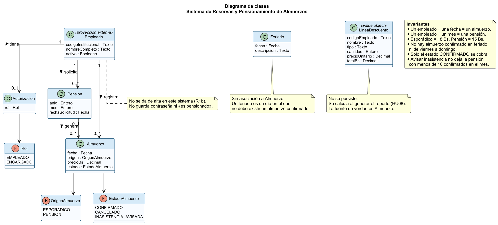

# Diagrama de clases

El diagrama muestra las entidades que el sistema guarda, sus atributos y las relaciones que salen de las reglas. No es el modelo de pantallas ni el de tablas con cada índice: eso se precisa al implementar, sin cambiar estas multiplicidades.

Fuente editable: [diagrams/clases.puml](../diagrams/clases.puml).

## Entidades

### Empleado

Proyección de la base institucional. Este sistema no da de alta personas (R1b, HU01).

| Atributo | Para qué está |
| --- | --- |
| codigoInstitucional | Identificador con el que la persona ingresa y con el que el reporte se puede cruzar en planilla. |
| nombreCompleto | Se muestra en la lista del día y en el reporte. |
| activo | Si la institución lo dio de baja, no ingresa (HU01, criterio 2). |

No tiene contraseña. La credencial, si la base real la pide, la resuelve el adaptador del directorio. No tiene el atributo «es pensionado»: la pensión es de un mes, no de la persona para siempre.

### Autorizacion

Dato de este sistema, no de la base institucional. Sirve para que el encargado vea feriados, lista del día y reporte.

| Atributo | Para qué está |
| --- | --- |
| rol | `EMPLEADO` o `ENCARGADO`. Si no hay fila, se trata como empleado. |

Un empleado tiene como máximo una autorización local.

### Pension

Una pensión activa de una persona para un año y un mes. Si la solicitud se rechaza, no se guarda una pensión «rechazada»: no se crea la fila. Por eso no hay un estado extra.

| Atributo | Para qué está |
| --- | --- |
| anio, mes | El mes pensionado. Junto con el empleado no se repiten (HU06, criterio 6). |
| fechaSolicitud | Deja evidencia de que se pidió antes de que empezara el mes. |

### Almuerzo

Un almuerzo de una persona en una fecha. Cubre la reserva esporádica y el día generado por la pensión. Es la unidad que la cocina cuenta y que el reporte cobra.

| Atributo | Para qué está |
| --- | --- |
| fecha | El día de servicio. |
| origen | `ESPORADICO` o `PENSION`. Define el precio y quién puede cancelar o avisar. |
| precioBs | 18 o 15, copiado al confirmar. Si el próximo año cambia la tarifa, los meses ya confirmados no se reescriben. |
| estado | `CONFIRMADO`, `CANCELADO` o `INASISTENCIA_AVISADA`. |

No hay un estado «asistió» o «no asistió». R7 cobra lo que sigue confirmado. El comedor no marca presencia.

`CANCELADO` es la reserva esporádica que el empleado anuló a tiempo. `INASISTENCIA_AVISADA` es el día de pensión avisado a tiempo. Los dos dejan de cobrarse, pero solo el segundo entra en la regla del mínimo de 10. Por eso no son el mismo valor.

Hay un solo almuerzo por empleado y fecha. Si cancela y vuelve a reservar antes de las 9:00, se actualiza esa misma fila. Así no aparecen dos cobros del mismo día.

### Feriado

Un día de lunes a jueves en el que el restaurante no atiende.

| Atributo | Para qué está |
| --- | --- |
| fecha | El día bloqueado. No se repite. |
| descripcion | Texto del encargado para reconocer el feriado (por ejemplo, 6 de agosto). |

No hay flecha de Feriado a Almuerzo. El feriado significa que ese día no debe existir un almuerzo confirmado. Guardar una clave foránea obligaría a crear el almuerzo para después apuntarlo a un feriado, que es lo contrario de la regla.

### LineaDescuento

No es una tabla. Es el resultado de calcular HU08. Se arma al exportar y se descarta después. Guardarla aparte duplicaría los almuerzos: si alguien corrige un feriado, el archivo viejo y la base dirían cosas distintas. La fuente es `Almuerzo`.

| Atributo | Para qué está |
| --- | --- |
| codigoEmpleado, nombre | Columnas que planilla necesita. |
| tipo | Pensionado o no pensionado en ese mes. |
| cantidad | Almuerzos que siguen confirmados. |
| precioUnitario | 15 o 18. |
| totalBs | cantidad × precioUnitario. |

En un mismo mes una persona no mezcla los dos precios: o es pensionada de ese mes, o no lo es.

## Relaciones y multiplicidades

| Relación | Multiplicidad | Por qué |
| --- | --- | --- |
| Empleado tiene Autorizacion | 1 a 0..1 | La mayoría solo come. El encargado es un empleado con un rol local. |
| Empleado solicita Pension | 1 a 0..* | Puede no pensionarse nunca, o pensionarse en varios meses. No al revés: una pensión es de una persona. |
| Empleado registra Almuerzo | 1 a 0..* | Cero si no usa el restaurante (R1, el uso es opcional). Muchos a lo largo de los meses. |
| Pension genera Almuerzo | 0..1 a 0..* | El almuerzo esporádico no tiene pensión, por eso el 0. Una pensión genera un almuerzo por día de servicio. Un almuerzo pertenece como máximo a una pensión. |

La pensión no «contiene» los almuerzos como único dueño en el sentido de que la lista del día no puede leerlos sin abrir la pensión. La cocina consulta por fecha. Por eso `Almuerzo` se guarda y se busca por sí mismo, y la pensión solo guarda la referencia en los que ella generó.

## Invariantes

Estas condiciones tienen que ser verdad después de cada caso de uso. Las pruebas del Sprint 1 y 2 salen de aquí y de los criterios de aceptación.

- Un empleado y una fecha: un solo almuerzo.
- Un empleado, un año y un mes: una sola pensión.
- Si el origen es esporádico, el precio es 18 Bs. Si el origen es pensión, el precio es 15 Bs.
- No hay almuerzo confirmado en feriado, viernes, sábado o domingo.
- El reporte suma solo los que están `CONFIRMADO`.
- Un aviso de inasistencia no deja a la pensión con menos de 10 confirmados en el mes.

## Cómo se lee contra las historias

| Historia | Qué toca del modelo |
| --- | --- |
| HU01 | Lee `Empleado`. No lo crea. Lee `Autorizacion` para el encargado. |
| HU02 | Crea o actualiza un `Almuerzo` esporádico. |
| HU03 | Pasa ese almuerzo a `CANCELADO`. |
| HU04 | Consulta `Almuerzo` confirmados de una fecha. |
| HU05 | Crea un `Feriado` y deja sin efecto el almuerzo de ese día. |
| HU06 | Crea una `Pension` y sus `Almuerzo`. |
| HU07 | Pasa un almuerzo de pensión a `INASISTENCIA_AVISADA` si el mes no baja de 10. |
| HU08 | Calcula `LineaDescuento` sin guardarla. |
| HU09 | Lee los mismos almuerzos que el reporte, para una sola persona. |
