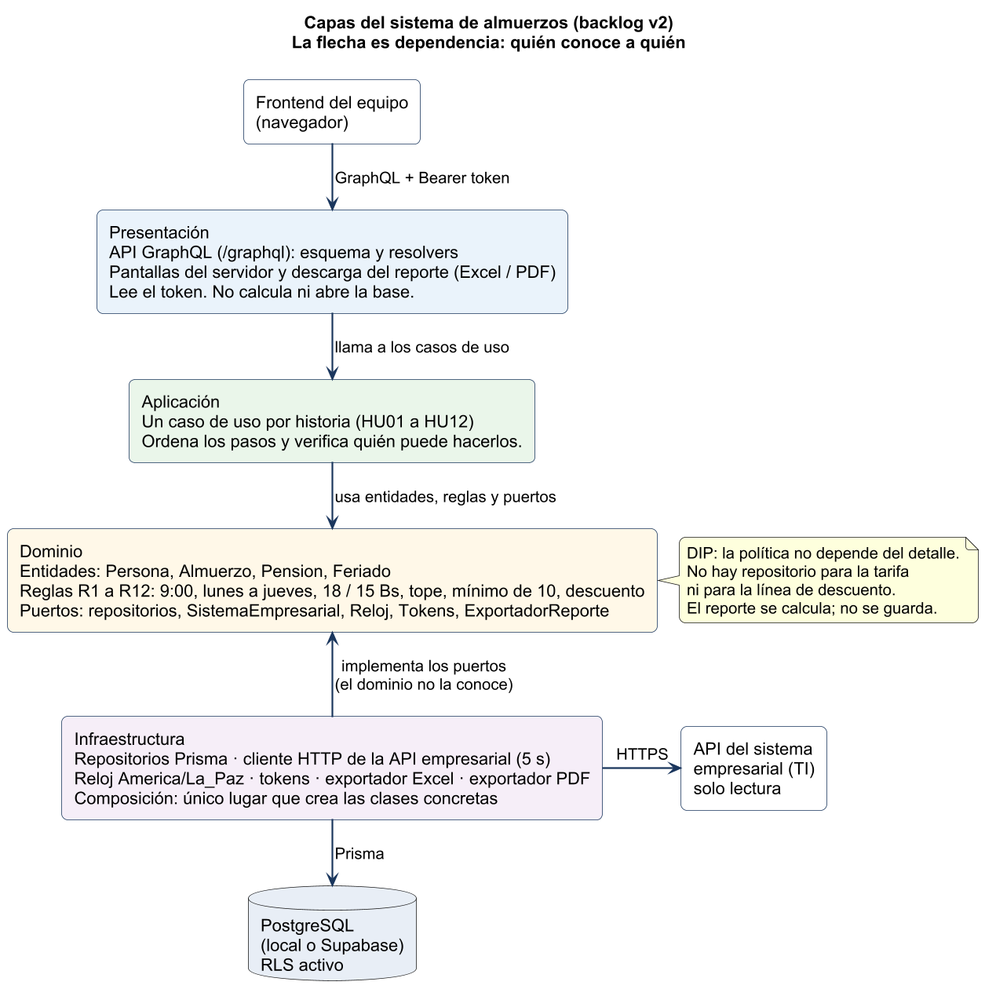

# Arquitectura y decisiones de diseño

El sistema es un solo producto con cuatro capas. Hay un restaurante, una institución y 46 puntos de historia, así que no hace falta partirlo en servicios. Un monolito con las dependencias en orden se puede explicar en la defensa y probar con dobles de prueba.

Este documento parte de la propuesta del equipo (documento «Arquitectura», Word: Node.js, Express, PostgreSQL y capas de rutas, controladores, servicios y repositorios) y del backlog v2. Mantiene esas piezas y agrega lo que la rúbrica pide y la propuesta no tenía escrito: hacia dónde apuntan las dependencias (DIP), dónde sí y dónde no se usa Repository e inyección, y cómo entra la API GraphQL que consume el frontend.



Fuente editable: [diagrams/arquitectura.puml](diagrams/arquitectura.puml).

## De la propuesta del equipo a las carpetas

| Propuesta del equipo | Aquí | Qué cambió y por qué |
| --- | --- | --- |
| `views/`, `public/` (EJS) | `src/presentacion/paginas.ts`, `estilos.css` | Pantallas mínimas del servidor para recorrer HU01 a HU04 sin frontend aparte. |
| — | `src/presentacion/graphql/` | **Nuevo**: la API GraphQL que consume el frontend del equipo. Es otra puerta de entrada al mismo sistema, al nivel de las rutas. |
| `routes/`, `controllers/`, `middlewares/` | `src/presentacion/web.ts`, `graphql/resolvers.ts`, `token.ts` | Reciben el pedido, sacan el token, llaman al caso de uso y arman la respuesta. No calculan precios ni abren la base. |
| `services/` | `src/aplicacion/` | Un caso de uso por historia (HU01 a HU12). |
| `models/` | `src/dominio/` | Entidades **y** reglas: hora límite, lunes a jueves, tarifas, tope, mínimo de 10, cálculo del descuento. También los **puertos** (interfaces). |
| `repositories/` | `src/infraestructura/repositoriosPrisma.ts` | Implementan los puertos con Prisma y PostgreSQL. |
| `integrations/empresarialApi.client.js` | `src/infraestructura/sistemaEmpresarialHttp.ts` | Igual que en la propuesta, pero implementa un puerto del dominio: los casos de uso no saben que hay HTTP. |
| `config/`, `.env` | `src/infraestructura/configuracion.ts`, `.env.example` | Lee y valida el entorno al arrancar. |
| `app.js` | `src/infraestructura/servidor.ts` y `composicion.ts` | El arranque y el único lugar que crea las clases concretas. |
| `database/` | `prisma/` | Esquema, migraciones SQL y datos iniciales. Ver [base-de-datos.md](base-de-datos.md). |
| JavaScript | TypeScript | Es JavaScript con tipos. Los puertos se escriben como `interface` y el compilador revisa que cada adaptador los cumpla. |

La diferencia de fondo con la propuesta: en ella la flecha va presentación → servicios → repositorios → PostgreSQL, así que los servicios dependen de la base. Aquí los servicios dependen de **interfaces** que ellos mismos definen, y la base las implementa. Esa es la Decisión 1.

## Capas

| Capa | Responsabilidad | Qué no hace |
| --- | --- | --- |
| Presentación | API GraphQL y pantallas del servidor. Lee el token, llama al caso de uso y devuelve el resultado o el mensaje. | No decide si son las 9:00, no calcula 15 × 12, no abre la base ni llama a la API empresarial. |
| Aplicación | Un caso de uso por historia: ordena los pasos y verifica quién puede hacerlos. | No tiene las reglas. Si en `ReservarAlmuerzo` apareciera `hora >= 9`, la regla se habría filtrado a la capa equivocada (está en `admiteCambio`, en el dominio). |
| Dominio | Entidades, reglas R1–R12 y puertos. | No importa Express, GraphQL, Prisma, `fetch` ni el reloj del sistema operativo. |
| Infraestructura | Implementa los puertos: PostgreSQL, API empresarial, reloj de La Paz, tokens, Excel y PDF. Arma la aplicación al arrancar. | No decide el mínimo de 10 ni el precio. |

La flecha del diagrama significa «esta capa conoce a esta otra». La presentación conoce la aplicación. La aplicación conoce el dominio. La infraestructura conoce los puertos del dominio para implementarlos. El dominio no tiene ninguna flecha hacia afuera.

Esto no queda solo escrito: [tests/capas.test.ts](../tests/capas.test.ts) revisa los `import` de cada carpeta y falla si el dominio importa algo de afuera, si la aplicación importa infraestructura o si la presentación abre Prisma.

## Decisión 1: las dependencias apuntan hacia el dominio (DIP)

El principio de inversión de dependencias pide que el código con la política no dependa del código con el detalle. Aquí la política son las reglas del almuerzo. El detalle es PostgreSQL, la API de TI, el archivo Excel o el reloj de Windows.

Por eso las interfaces están en [src/dominio/puertos.ts](../src/dominio/puertos.ts):

| Puerto | Lo necesita | Implementación real | En las pruebas |
| --- | --- | --- | --- |
| `Reloj` | La regla de las 9:00 y los 30 minutos de sesión | `RelojDelSistema` (America/La_Paz) | `RelojDePrueba`, que se fija en 8:59 o 9:00 |
| `SistemaEmpresarial` | HU01, HU05 | `SistemaEmpresarialHttp` (timeout 5 s) | `EmpresarialEnMemoria`, que puede «caerse» |
| `PersonaRepositorio`, `AlmuerzoRepositorio`, `PensionRepositorio`, `FeriadoRepositorio`, `AutorizacionRepositorio`, `SesionRepositorio` | Todas las historias | Clases `…Prisma` | Clases `…EnMemoria` |
| `GeneradorDeTokens` | HU01 | `TokensAleatorios` (256 bits, SHA-256) | `TokensDePrueba` (predecibles) |
| `ExportadorReporte` | HU11 CA3 | `ExportadorExcel`, `ExportadorPdf` | `ExportadorDePrueba`, que no escribe disco |

`ReservarAlmuerzo` recibe estos puertos y no sabe cuál de las dos implementaciones le llegó. Eso es la inversión: el caso de uso no depende de la infraestructura; la infraestructura depende del caso de uso.

El ejemplo más claro es la API empresarial. Todavía no tenemos la real de TI. El simulador y el adaptador HTTP siguen las rutas referenciales del backlog §2.3. El día que TI entregue la suya, se cambia **un archivo** (`sistemaEmpresarialHttp.ts`) y ningún caso de uso.

Dónde **no** se invierte nada, porque no hay un detalle que cambiar:

- La tarifa de 18 Bs y 15 Bs es una regla, no un servicio. Es una función del dominio (`precioDe`). Inventar una interfaz `ITarifa` con una sola implementación no aporta y obliga a mockear la regla en las pruebas. La rúbrica pide mocks útiles, no un mock por clase.
- El mínimo de 10, el tope diario y el cálculo del descuento están en la misma situación: son reglas puras. Se prueban llamándolas, no reemplazándolas.
- Las entidades se arman con funciones del dominio (`personaDelEmpleado`, `personaDelFamiliar`). Una entidad no se inyecta.

## Decisión 2: Repository solo en lo que se guarda

Un repositorio es la colección de un agregado: lo busca y lo guarda, y esconde la tabla. Hay uno por cada cosa que este sistema persiste y vuelve a buscar.

| Puerto | Lo usa | Por qué es un repositorio |
| --- | --- | --- |
| Personas | HU01, HU04–HU06, HU09–HU12 | Copia local de empleados y familiares (backlog §2.2 paso 5). |
| Almuerzos | HU02–HU04, HU06, HU08–HU12 | Se buscan por persona y fecha, por titular y mes, y por día. |
| Pensiones | HU02, HU08, HU09, HU12 | Hay que saber si esa persona ya está pensionada ese mes. |
| Feriados | HU02, HU04, HU07, HU08, HU10–HU12 | El calendario de servicio pregunta por una fecha o un mes. |
| Autorizaciones | HU01 | El rol de encargado no viene de la API (S4). |
| Sesiones | HU01 CA5 | La sesión propia tiene que sobrevivir a varios pedidos y vencer a los 30 minutos. |

`PensionRepositorio.registrar` guarda la pensión y todos sus almuerzos en una transacción. Así nunca queda una pensión sin días ni días sin pensión.

Dónde **no** hay repositorio:

| Cosa | Por qué no |
| --- | --- |
| Reporte y `LineaDescuento` | Se calculan al vuelo desde los almuerzos (`calcularDescuentos`). Si se guardaran, un feriado cargado tarde dejaría un reporte viejo contradiciendo la base (HU07 CA2). |
| Tarifa 15 / 18 | Es regla fija de R2 y R3. El día que el precio cambie por configuración, ahí sí aparece un puerto. Hoy sería una tabla de más. |
| Tope diario, mínimo de 10, hora límite | No se leen de la base: se calculan. |
| Alta de empleados o familiares | No es nuestro agregado (R1b). No existe `guardarEmpleado` público: la copia local solo se actualiza desde la API en `sincronizar`. |

## Decisión 3: inyección de dependencias donde hay más de una implementación

La inyección es por constructor: el caso de uso recibe sus puertos al crearse y no los busca con un `new` de la clase concreta ni con un singleton global.

Hay dos lugares que conocen las clases concretas:

- [src/infraestructura/composicion.ts](../src/infraestructura/composicion.ts) al arrancar el servidor: Prisma, HTTP, reloj real, Excel y PDF;
- [tests/fakes.ts](../tests/fakes.ts) (`escenario()`) en las pruebas: memoria, reloj fijo y exportador de prueba.

Los dos llaman a la misma función, [crearCasosDeUso](../src/aplicacion/casosDeUso.ts). Así, lo que se prueba es exactamente lo que corre en producción, cambiando solo los adaptadores.

| Se inyecta | Motivo |
| --- | --- |
| Repositorios | En producción hablan con PostgreSQL. En la prueba son memoria. |
| Sistema empresarial | En producción es HTTP contra TI (o el simulador). En la prueba se puede «caer» para HU01 CA4. |
| Reloj | Las pruebas de las 8:59 y de las 9:00 no pueden depender de la hora en que corre el test. |
| Generador de tokens | En la prueba los tokens son predecibles; en producción, aleatorios. |
| Exportadores | Excel y PDF son dos implementaciones del mismo puerto. El cálculo no sabe cuál se eligió. |

Dónde **no** se inyecta:

- Las reglas de hora, calendario, tope y mínimo de 10. Tienen una sola forma correcta. Inyectarlas permitiría que un test reemplace la regla y termine probando el reemplazo.
- Las entidades. Se construyen dentro del caso de uso.
- La presentación no recibe repositorios. Recibe los casos de uso. Si un resolver abriera Prisma, la separación de capas ya no existiría (y `capas.test.ts` fallaría).

## Decisión 4: la API GraphQL es una entrada más, no una capa nueva

El equipo pidió que el frontend consuma una API GraphQL. GraphQL entra como **adaptador de presentación**, al mismo nivel que las rutas de Express:

```text
Frontend del equipo ──GraphQL──▶ resolvers ──▶ casos de uso ──▶ dominio
Pantallas del servidor ──HTTP──▶ web.ts    ──┘
```

- Los resolvers ([resolvers.ts](../src/presentacion/graphql/resolvers.ts)) no tienen reglas: sacan el usuario de la sesión, llaman al caso de uso y traducen el resultado.
- Un rechazo de negocio en una mutación vuelve como `ok: false` y un `mensaje`, no como error. Para la pantalla es una respuesta esperada («ya son las 9:00»), no una falla.
- Sin sesión vuelve `UNAUTHENTICATED`; si no es encargado, `FORBIDDEN`. Un error inesperado sale como «Unexpected error.» sin detalles internos.
- El reporte en Excel o PDF se descarga por `GET /api/reportes/AAAA/M.xlsx`, porque GraphQL no transporta archivos binarios.

Contrato y ejemplos para el frontend: [api-graphql.md](api-graphql.md).

**Por qué no se consume Supabase directo.** Supabase ofrece su propia API (REST y GraphQL) sobre las tablas. Usarla desde el frontend saltaría la aplicación y el dominio: una pantalla podría guardar una reserva a las 10:00 o a 5 Bs. Es justo lo que la rúbrica marca como insuficiente («lógica de negocio mezclada con interfaz o datos»). Por eso Supabase se usa **solo como PostgreSQL**, y todas las tablas tienen RLS sin políticas para que esa API no exponga nada (ver [base-de-datos.md](base-de-datos.md)).

## Decisión 5: sesión propia con token opaco

HU01 pide una sesión propia que venza a los 30 minutos sin uso. Se eligió un token aleatorio guardado en la base, y no un JWT:

| Opción | Por qué |
| --- | --- |
| Token aleatorio en tabla `sesion` (elegido) | La inactividad se mide en el servidor (`ultima_actividad`) y cada pedido la renueva. Cerrar sesión borra la fila y el token deja de servir al instante. En la base queda solo el SHA-256. |
| JWT firmado | Un JWT no se puede revocar antes de que expire y su vencimiento es fijo, no por inactividad. Habría que agregar una lista negra, que es una tabla de sesiones con otro nombre. |

El token viaja como `Authorization: Bearer` (frontend) o en cookie `HttpOnly` (pantallas del servidor). La contraseña nunca se guarda: va a la API empresarial y se descarta (backlog §2.2).

## Decisión 6: reloj y zona horaria

Todas las comparaciones con las 9:00 usan el puerto `Reloj` en `America/La_Paz` (UTC−4, sin horario de verano). Si se usara la hora del servidor sin zona, un despliegue en otro país (Supabase y muchos hostings están en UTC) rompería la regla del restaurante. El criterio «8:59 acepta, 9:00 rechaza» se prueba fijando ese reloj, no esperando a que sean las nueve.

## Decisión 7: dos exportadores, un cálculo

`GenerarReporteMensual` arma los `DescuentoTitular` en el dominio. `ExportarReporteMensual` elige el exportador según el formato pedido y le pasa esos mismos datos. La condición del `extend` del caso de uso (el encargado eligió exportar y el formato) se resuelve en la aplicación al elegir la implementación. No hay un `if` de formato dentro del cálculo de los 15 Bs y los 18 Bs. La prueba de HU11 CA3 comprueba que Excel y PDF reciben exactamente lo mismo que se ve en pantalla.

## Qué no se hace, y por qué

| Alternativa | Por qué no |
| --- | --- |
| Frontend que escribe directo en Supabase | Saltaría las reglas. Ver Decisión 4. |
| Lógica de negocio en el resolver, en la pantalla o en SQL | La rúbrica lo marca como insuficiente: la regla no se podría probar sin la base. La base repite algunas reglas como `CHECK`, pero solo como segunda defensa. |
| Microservicios (reservas, pensión, reporte) | Partirían historias que ya son pequeñas y obligarían a integrar red antes de tener un incremento demostrable. |
| Guardar la contraseña o un hash de ella | El backlog lo prohíbe: la valida la API empresarial. |
| Tabla de empleados con alta y baja | Contradice R1b. La copia local se llena solo desde la API. |
| Conexión directa con planilla | Fuera de alcance. El reporte produce el archivo y una persona lo entrega. |

## Del caso de uso a las capas

Ejemplo con reservar para un familiar (HU06), que es el que más reglas junta:

1. El frontend manda `reservarAlmuerzo(fecha: "2026-10-27", personaId: "FAM-2002")` con su token. No manda precio ni titular.
2. El resolver valida el token (`ValidarSesion`) y obtiene el usuario. Llama a `ReservarAlmuerzo`.
3. El caso de uso pide al repositorio de personas a Juan y comprueba que sea un familiar vigente **de ese titular** (R9).
4. El dominio responde si la fecha es válida, si es lunes a jueves, si no es feriado y si todavía no son las 9:00 de ese día.
5. La aplicación revisa que Juan no esté pensionado ese mes, que no tenga otro almuerzo ese día y que la familia no pase su tope.
6. Si todo pasa, se guarda un `Almuerzo` a nombre de Juan, esporádico, a 18 Bs, con el empleado como titular del descuento.
7. Si algo falla, no se escribe nada. El caso de uso devuelve el mensaje y el frontend lo muestra tal cual.

## Estructura del código

```text
src/dominio/            reglas, entidades y puertos (no importa nada de afuera)
src/aplicacion/         un caso de uso por historia + crearCasosDeUso
src/presentacion/       graphql/ (esquema y resolvers), pantallas y descarga del reporte
src/infraestructura/    Prisma, API empresarial HTTP, reloj, tokens, exportadores, arranque
simulador-empresarial/  la API de TI simulada (mientras no tengamos la real)
prisma/                 esquema, migraciones y datos iniciales
tests/                  una prueba por historia, integración GraphQL, HTTP y PostgreSQL
```

## Stack

La rúbrica evalúa la práctica, no la herramienta. Las cuatro capas no cambian si después se cambia de librería.

| Pieza | Elección | Motivo |
| --- | --- | --- |
| Lenguaje | TypeScript sobre Node.js | JavaScript con tipos: los puertos se verifican al compilar. |
| Servidor | Express | El de la propuesta del equipo. |
| API | GraphQL con GraphQL Yoga | Pedido del equipo para el frontend. Yoga se monta sobre Express y trae GraphiQL para explorar. |
| Base | PostgreSQL (local o Supabase) con Prisma | El de la propuesta. Prisma da migraciones versionadas y consultas parametrizadas (§7 de la propuesta). |
| API empresarial | Adaptador HTTP con `fetch` y timeout de 5 s; simulador con Express | Backlog §2.3 y §2.4. |
| Excel y PDF | ExcelJS y PDFKit | Dos implementaciones del mismo puerto. |
| Pruebas | Vitest y cobertura V8 | Reloj, API y repositorios en memoria; además, integración contra HTTP y PostgreSQL. |

## Qué tiene que poder explicar cada integrante

- Por qué el frontend no escribe directo en Supabase.
- Por qué la pantalla (o el resolver) no calcula el monto.
- Por qué `LineaDescuento` no es una tabla.
- Por qué hay repositorio de almuerzos y no de tarifas.
- Por qué el reloj y la API empresarial son puertos.
- Qué cambia en el código el día que TI entregue la API real.
- Por qué la sesión es un token en la base y no un JWT.

