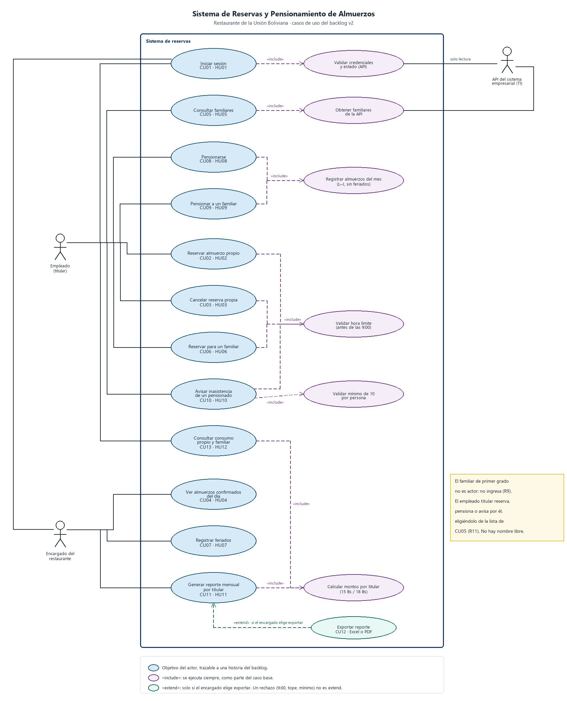

# Casos de uso (versión 2)

Sistema de reservas del restaurante «Rumbo al Cielo» · Unión Boliviana. Alineado con el [backlog v2](backlog.md).

> Fuente: documento del equipo «Diagrama y descripción de casos de uso – versión 2». El texto de los flujos es el del equipo. El diagrama se redibujó con las correcciones de la sección «Qué se corrigió del diagrama» (detalle en [revision-documentos-v2.md](revision-documentos-v2.md)).

| Control del documento | Detalle |
| --- | --- |
| Base de requisitos | Backlog e historias de usuario, versión 2 |
| Propósito | Alinear actores, casos de uso, relaciones, trazabilidad y flujos con las 12 historias vigentes. |
| Alcance | Autenticación mediante API empresarial, reservas propias y de familiares, pensiones, feriados, inasistencias, consulta de consumo y reportes. |
| Criterio importante | Los familiares de primer grado son beneficiarios, pero no ingresan al sistema; el empleado titular actúa en su nombre. |

Fuente: [diagrams/render_casos_de_uso.py](diagrams/render_casos_de_uso.py) (posiciones fijas, para que las flechas no se crucen) y [diagrams/casos-de-uso.puml](diagrams/casos-de-uso.puml) como versión en texto.

## 1. Actores

| Actor | Tipo | Objetivo e interacción |
| --- | --- | --- |
| Empleado (titular) | Persona; actor principal | Inicia sesión con credenciales empresariales; reserva y cancela almuerzos propios; consulta familiares; reserva o pensiona familiares; avisa inasistencias de los pensionados a su cargo (él o un familiar) y consulta el consumo mensual propio y familiar. |
| Encargado del restaurante | Persona; actor con permisos específicos | Consulta la lista diaria, registra feriados, genera el reporte mensual agrupado por titular y lo exporta a Excel o PDF. |
| API del sistema empresarial | Sistema externo; actor secundario | Valida las credenciales, devuelve los datos del empleado y la lista de familiares de primer grado. Se consume en modo de solo lectura. |
| Familiar de primer grado | Beneficiario, **no actor** | Consume almuerzos, pero no inicia sesión. El empleado titular hace en su nombre las reservas, pensiones y avisos (R9). |

## 2. Relaciones «include» y «extend»

| Relación | Tipo | Justificación |
| --- | --- | --- |
| CU01 → Validar credenciales y estado (API) | «include» | Todo inicio de sesión pasa por la API empresarial (R12). |
| CU05 → Obtener familiares de la API | «include» | La lista sale de la API; no se agregan personas a mano (HU05 CA2). |
| CU08 y CU09 → Registrar almuerzos del mes | «include» | Al confirmar una pensión, propia o de un familiar, siempre se generan los almuerzos de los días de servicio sin feriados (R4). |
| CU02, CU03, CU06, CU10 → Validar hora límite | «include» | Reservar, cancelar y avisar siempre comprueban las 9:00 (R2b). |
| CU10 → Validar mínimo de 10 por persona | «include» | Todo aviso comprueba el mínimo de esa persona (R5, R6). |
| CU11 y CU13 → Calcular montos por titular | «include» | El reporte y el consumo usan el mismo cálculo de 15 y 18 Bs. |
| CU12 → CU11 | «extend» | Exportar es opcional: el encargado puede revisar el reporte en pantalla y solo exporta si lo pide. La flecha va de CU12 hacia CU11. |

`include` es comportamiento que siempre ocurre; `extend`, comportamiento opcional bajo una condición. Los rechazos (las 9:00, el tope, el mínimo de 10) son **flujos alternativos**, no `extend`.

Iniciar sesión (CU01) es una **precondición** de los demás casos, no un `include` de cada uno: si fuera `include`, cada reserva pediría usuario y contraseña de nuevo.

## 3. Trazabilidad

| HU | Historia (v2) | Actor | Caso de uso | Sprint |
| --- | --- | --- | --- | --- |
| HU01 | Iniciar sesión con usuario del sistema empresarial | Empleado; encargado; API | CU01 Iniciar sesión | S1 |
| HU02 | Reservar mi almuerzo (uso esporádico) | Empleado | CU02 Reservar almuerzo propio | S1 |
| HU03 | Cancelar mi reserva (uso esporádico) | Empleado | CU03 Cancelar reserva propia | S1 |
| HU04 | Ver almuerzos confirmados del día | Encargado | CU04 Ver almuerzos del día | S1 |
| HU05 | Ver mis familiares habilitados | Empleado; API | CU05 Consultar familiares | S2 |
| HU06 | Reservar almuerzo para un familiar | Empleado | CU06 Reservar para familiar | S2 |
| HU07 | Registrar feriados del mes | Encargado | CU07 Registrar feriados | S2 |
| HU08 | Pensionarme | Empleado | CU08 Pensionarse | S2 |
| HU09 | Pensionar a un familiar | Empleado | CU09 Pensionar familiar | S3 |
| HU10 | Avisar inasistencia de un pensionado | Empleado | CU10 Avisar inasistencia | S3 |
| HU11 | Generar reporte mensual por titular | Encargado | CU11 Generar reporte; CU12 Exportar | S4 |
| HU12 | Ver mi consumo del mes (y de mi familia) | Empleado | CU13 Consultar consumo | S4 |

En el código, cada caso de uso es una clase de `src/aplicacion/` con el mismo nombre (por ejemplo, CU06 → `ReservarAlmuerzo` con la persona elegida; CU12 → `ExportarReporteMensual`).

## 4. Reglas de negocio aplicadas

| Código | Regla |
| --- | --- |
| R1–R1b | Almuerzos de lunes a jueves; empleados y familiares ya existen en el sistema empresarial y se consultan por API de solo lectura. |
| R2 | La reserva esporádica cuesta 18 Bs y se registra a nombre de quien consume. |
| R2b | Reservar, cancelar o avisar para el día se permite solo antes de las 9:00; desde las 9:00 se rechaza. |
| R3–R4 | La pensión cuesta 15 Bs por persona y se pide antes de que empiece el mes. Los almuerzos se registran solos para cada día de servicio no feriado. |
| R5–R6 | El mínimo de 10 se controla por pensionado. Un aviso no puede dejar a esa persona por debajo del mínimo. |
| R7–R8 | Las faltas sin aviso oportuno se cobran. El reporte se agrupa por titular y detalla cada persona; el descuento es por planilla. |
| R9–R11 | Los familiares no ingresan. Cada reserva y pensión es nominal; el máximo diario es el titular más sus familiares habilitados. |
| R12 | Solo empleados activos ingresan; la API valida las credenciales. Si no responde en 5 s, se niega el acceso y se informa. |

## 5. Descripción de los casos de uso

Las llamadas a la API son externas; la contraseña no se guarda en el sistema del restaurante.

### CU01 – Iniciar sesión

| Campo | Descripción |
| --- | --- |
| Historia | HU01 |
| Actores | Empleado o encargado; secundario: API del sistema empresarial. |
| Precondición | El usuario tiene credenciales del sistema empresarial. |
| Flujo principal | 1. El usuario escribe su usuario y contraseña empresarial. 2. El sistema envía las credenciales a la API por HTTPS, sin guardar la contraseña. 3. La API valida y devuelve un identificador o token. 4. El sistema consulta los datos del empleado y verifica que esté activo. 5. El sistema actualiza la copia local de familiares de primer grado. 6. El sistema crea una sesión propia que vence tras 30 minutos de inactividad y muestra las opciones según el rol. |
| Flujos alternativos | 1. Credenciales incorrectas: «Usuario o contraseña incorrectos» y no inicia sesión. 2. Empleado inexistente o inactivo: se niega el acceso. 3. La API no responde en 5 s o da error: «No se pudo validar tu usuario, intenta más tarde» y no ingresa. 4. Sesión inactiva por 30 minutos: se pide iniciar sesión de nuevo. |
| Postcondición | El usuario queda autenticado y autorizado según su rol. |

### CU02 – Reservar almuerzo propio

| Campo | Descripción |
| --- | --- |
| Historia | HU02 |
| Actor | Empleado no pensionado ese mes. |
| Precondición | Inició sesión; no tiene otro almuerzo esa fecha. |
| Flujo principal | 1. Elige la fecha. 2. El sistema comprueba que sea lunes a jueves y no feriado. 3. Si es para hoy, verifica que sea antes de las 9:00. 4. Comprueba que no exista reserva ni almuerzo de pensión para esa persona y fecha. 5. El empleado confirma. 6. Se registra una reserva nominal de 18 Bs que aparece en «Mis reservas». |
| Flujos alternativos | 1. Viernes a domingo o feriado: no hay servicio, no se registra. 2. A las 9:00 o después: se rechaza para ese día. 3. Ya hay almuerzo propio ese día: no se duplica. |
| Postcondición | La reserva queda a nombre del empleado y aparece en la lista diaria del encargado. |

### CU03 – Cancelar reserva propia

| Campo | Descripción |
| --- | --- |
| Historia | HU03 |
| Actor | Empleado. |
| Precondición | Tiene una reserva esporádica activa. |
| Flujo principal | 1. Abre «Mis reservas» y elige la reserva. 2. El sistema valida que sea antes de las 9:00 del día del almuerzo. 3. Confirma. 4. La reserva queda cancelada y sale del conteo y del cobro. |
| Flujos alternativos | 1. A las 9:00 o después: no se cancela; se informa que se cobrará aunque no asista. |
| Postcondición | La reserva cancelada no aparece como confirmada ni entra al importe del mes. |

### CU04 – Ver almuerzos confirmados del día

| Campo | Descripción |
| --- | --- |
| Historia | HU04 |
| Actor | Encargado. |
| Precondición | Inició sesión con permisos de encargado. |
| Flujo principal | 1. Elige el día. 2. El sistema reúne las reservas esporádicas activas y los almuerzos confirmados de pensionados. 3. Excluye cancelaciones, avisos y feriados. 4. Muestra el total y una fila por persona con nombre, tipo (empleado o familiar), titular y modalidad. |
| Flujos alternativos | 1. Feriado o día sin servicio: se informa que no hay almuerzos. 2. Sin reservas: total 0 y «No hay almuerzos confirmados para hoy». |
| Postcondición | El encargado sabe cuántos almuerzos preparar. |

### CU05 – Consultar familiares habilitados

| Campo | Descripción |
| --- | --- |
| Historia | HU05 |
| Actores | Empleado; secundario: API empresarial. |
| Precondición | Inició sesión. |
| Flujo principal | 1. Abre «Mi familia». 2. El sistema consulta la copia local actualizada desde la API. 3. Muestra nombre y parentesco de cada familiar. 4. Calcula el tope diario: 1 + familiares habilitados. |
| Flujos alternativos | 1. Sin familiares: mensaje y tope 1. 2. Alguien que no es de primer grado en la API: no aparece y no se puede agregar a mano. |
| Postcondición | El empleado sabe por quiénes puede reservar o pensionar. |

### CU06 – Reservar almuerzo para un familiar

| Campo | Descripción |
| --- | --- |
| Historia | HU06 |
| Actor | Empleado titular. |
| Precondición | El familiar figura en la lista vigente de CU05. |
| Flujo principal | 1. Elige un familiar y la fecha. 2. El sistema revalida que siga habilitado y que sea día de servicio no feriado. 3. Si es para hoy, verifica que sea antes de las 9:00. 4. Comprueba que el familiar no tenga otro almuerzo ese día y que no se pase el tope diario. 5. Confirma y queda el almuerzo a nombre del familiar, a 18 Bs, vinculado al titular. |
| Flujos alternativos | 1. Familiar no habilitado, duplicado, día sin servicio, hora vencida o tope alcanzado: se rechaza. 2. Cancelar la reserva de un familiar antes de las 9:00 cancela solo esa; las demás siguen. |
| Postcondición | El almuerzo queda a nombre del familiar y el descuento al titular. No hay nombres libres ni almuerzos genéricos. |

### CU07 – Registrar feriados

| Campo | Descripción |
| --- | --- |
| Historia | HU07 |
| Actor | Encargado. |
| Flujo principal | 1. Elige la fecha y escribe la descripción. 2. El sistema verifica que sea lunes a jueves. 3. Confirma. 4. La fecha queda como feriado y sale de reservas, pensiones y cobros. |
| Flujos alternativos | 1. Viernes a domingo: no hay servicio ordinario, no hace falta registrarlo. 2. Si ya había almuerzos confirmados esa fecha, se excluyen del reporte y del cobro. |
| Postcondición | El feriado no suma almuerzos ni importes para nadie. |

### CU08 – Pensionarse para el mes siguiente

| Campo | Descripción |
| --- | --- |
| Historia | HU08 |
| Actor | Empleado. |
| Precondición | No tiene pensión para el mes objetivo. |
| Flujo principal | 1. Elige «Pensionarme» para el mes siguiente. 2. El sistema verifica que sea antes del inicio de ese mes. 3. Calcula los días de lunes a jueves sin feriados y muestra el importe a 15 Bs. 4. Confirma. 5. Se registra la pensión nominal y se ejecuta «Registrar almuerzos del mes». |
| Flujos alternativos | 1. El mes ya empezó: se rechaza. 2. Ya tiene pensión: no se duplica. 3. Con almuerzo de pensión ese día, no se permite una reserva esporádica adicional. 4. Si los feriados dejan menos de 10 días de servicio, se rechaza. |
| Postcondición | Queda pensionado con sus almuerzos confirmados a 15 Bs. |

### CU09 – Pensionar a un familiar

| Campo | Descripción |
| --- | --- |
| Historia | HU09 |
| Actor | Empleado titular. |
| Flujo principal | 1. Elige uno o varios familiares para el mes siguiente. 2. El sistema revalida que cada uno esté habilitado y que sea antes del inicio del mes. 3. Comprueba que no haya pensión duplicada ni se pase el tope. 4. Confirma. 5. Se registra una pensión separada por familiar y sus almuerzos del mes a 15 Bs. |
| Flujos alternativos | 1. Mes empezado, familiar no habilitado o ya pensionado: se rechaza esa persona; las demás siguen. 2. El titular puede pensionar a un familiar aunque él no esté pensionado. |
| Postcondición | Cada familiar queda pensionado por separado; los importes van al titular. |

### CU10 – Avisar inasistencia de un pensionado

| Campo | Descripción |
| --- | --- |
| Historia | HU10 |
| Actor | Empleado titular (para sí o para un familiar pensionado). |
| Precondición | La persona tiene un almuerzo de pensión confirmado ese día. |
| Flujo principal | 1. Elige a la persona y el día. 2. El sistema verifica que sea antes de las 9:00. 3. Calcula cuántos almuerzos le quedarían a esa persona en el mes. 4. Si conserva al menos 10, confirma. 5. Se libera solo el almuerzo de esa persona y sale del cobro. |
| Flujos alternativos | 1. A las 9:00 o después: se rechaza y se cobra. 2. Quedaría con menos de 10: se rechaza; el mínimo es por persona. 3. Sin aviso a tiempo y sin asistir: se descuenta. |
| Postcondición | El aviso afecta a una sola persona. |

### CU11 – Generar reporte mensual por titular

| Campo | Descripción |
| --- | --- |
| Historia | HU11 |
| Actor | Encargado. |
| Flujo principal | 1. Elige el mes. 2. El sistema reúne los almuerzos confirmados no cancelados, sin feriados. 3. Agrupa por titular y desglosa cada persona. 4. Aplica 15 Bs a pensión y 18 Bs a esporádico. 5. Muestra persona, parentesco, modalidad, cantidad, precio, subtotal y total por titular. |
| Flujos alternativos | 1. Mes sin consumos: se informa y no aparecen titulares sin consumo. 2. Lo no cancelado a tiempo se cobra aunque no haya asistido. |
| Postcondición | El encargado tiene los totales para el descuento por planilla. Ejemplo: 12 × 15 + 10 × 15 + 3 × 18 = 384 Bs. |

### CU12 – Exportar reporte mensual

| Campo | Descripción |
| --- | --- |
| Historia | HU11 CA3 |
| Actor | Encargado. |
| Precondición | Hay un reporte generado en CU11. |
| Flujo principal | 1. Elige «Exportar». 2. El sistema ofrece Excel y PDF. 3. Elige el formato. 4. Se genera el archivo con los mismos datos y totales de la pantalla. |
| Postcondición | El archivo queda listo para revisar y enviar a planilla. |

### CU13 – Consultar consumo propio y familiar

| Campo | Descripción |
| --- | --- |
| Historia | HU12 |
| Actor | Empleado. |
| Flujo principal | 1. Abre «Mi consumo» y elige el mes. 2. Ve el detalle nominal suyo y de cada familiar. 3. Ve modalidad, cantidad, precio y subtotal por persona. 4. Ve el total que se le descontará. 5. Para cada pensionado, ve cuántos almuerzos lleva y cuántas inasistencias más puede avisar sin bajar de 10. |
| Flujos alternativos | 1. Sin almuerzos: 0 almuerzos y 0 Bs. |

## 6. Pendientes con el Product Owner

Los puntos S1 a S5 siguen abiertos. Están en el [backlog](backlog.md#supuestos-y-preguntas-abiertas-validar-con-el-product-owner), junto con lo que hace hoy el código en cada caso.

## 7. Qué se corrigió del diagrama

| En el diagrama del Word | Problema | Cómo quedó |
| --- | --- | --- |
| La figura 1 numera UC01 a UC12 con las historias de la v1 (por ejemplo, «Solicitar pensionamiento UC06 · HU06», «Generar reporte UC08 · HU08») y agrega abajo UC10 a UC12 | No coincide con la tabla de trazabilidad del mismo documento (CU08 = HU08 Pensionarse, CU11 = HU11 Reporte) | Numeración CU01 a CU13 igual a la tabla. |
| La figura 2 tiene dos óvalos «Iniciar sesión (UC01)», y usa UC02, UC03, UC08, UC10, UC12, UC14 y UC25 con otros significados | Un caso de uso aparece dos veces y los números no corresponden a nada del texto | Un solo CU01. |
| Todos los casos tienen «include» hacia Iniciar sesión, con flechas de dos puntas | Iniciar sesión es precondición, no comportamiento incluido. Además «include» tiene una sola dirección | CU01 como precondición, escrito en cada caso. |
| «Validar empleado en base de datos» | En la v2 se valida contra la API, no contra una base propia | «Validar credenciales y estado (API)». |
| Asociaciones del encargado que llegan a casos del empleado y una línea diagonal suelta | El encargado no reserva ni pensiona por otros | El encargado solo se asocia a CU01, CU04, CU07 y CU11. |
| Actor «Empleado pensionado» como especialización | En la v2 el titular avisa también por un familiar pensionado aunque él no lo esté; la especialización ya no separa a nadie | Un solo actor «Empleado (titular)». |
| Dos «extend» separados para Excel y PDF | El texto (CU12) tiene un solo caso de exportar con dos formatos | Un solo CU12 que extiende a CU11. |
