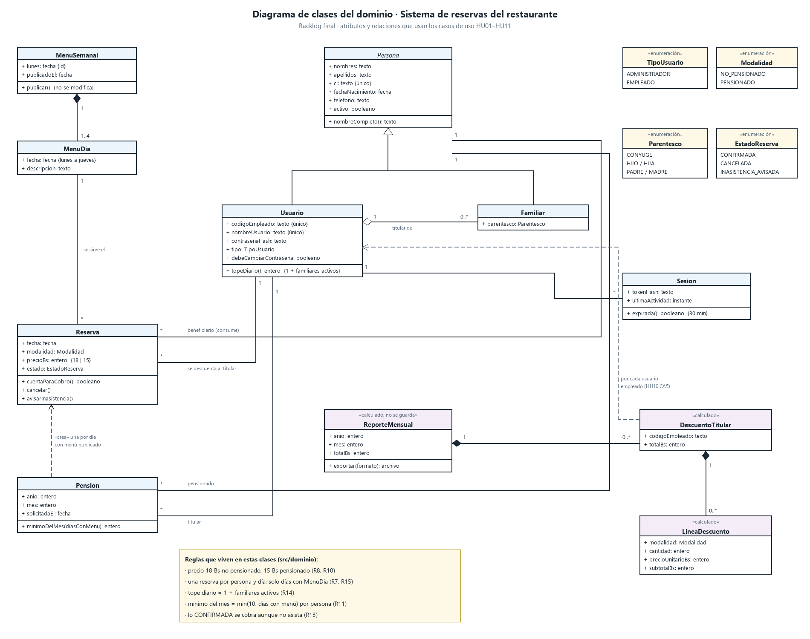

# Diagrama de clases

Es el modelo del dominio que usan los casos de uso. Cada clase está en `src/dominio/modelo.ts` (y `reporte.ts` para las calculadas); la tabla de la última sección dice cómo se guarda cada una.

## Clases y por qué existen

| Clase | Atributos clave | Historia | Por qué está |
| --- | --- | --- | --- |
| **Persona** (abstracta) | nombres, apellidos, ci {único}, fechaNacimiento, telefono, activo | HU01, HU09 | R4: usuario y familiar se registran con los mismos datos personales. La baja es `activo = false`, no un borrado: el consumo anterior sigue en el reporte. |
| **Usuario** | codigoEmpleado {único}, nombreUsuario {único}, contrasenaHash, tipo, debeCambiarContrasena | HU01, HU02, HU09 | Es quien ingresa (R2, R5) y el titular a quien se descuenta (R16). La contraseña solo como hash. |
| **Familiar** | parentesco | HU01, HU09 | R4: primer grado, sin credenciales. Hereda los datos personales. |
| **MenuSemanal** | lunes {id}, publicadoEl | HU03 | R6: se publica una vez por semana y no se modifica. |
| **MenuDia** | fecha, descripcion | HU03 | R7: solo los días con MenuDia tienen atención. |
| **Reserva** | fecha, modalidad, precioBs, estado | HU04, HU05, HU07, HU08 | R15: un almuerzo nominal por persona por día. Una sola clase para el no pensionado y el pensionado: cambian el precio y la modalidad, no las reglas de la lista ni del cobro. |
| **Pension** | anio, mes, solicitadaEl | HU07 | R10: por persona y por mes. Crea una Reserva por cada día con menú de ese mes. |
| **Sesion** | tokenHash, ultimaActividad | HU02 CA7 | 30 minutos de inactividad. |
| **ReporteMensual**, **DescuentoTitular**, **LineaDescuento** | «calculado» | HU10, HU11 | Se arman desde las reservas cada vez que se piden. No se guardan: un reporte guardado podría quedar distinto de las reservas si alguien cancela tarde o se corrige un dato. |

Enumeraciones: `TipoUsuario` (ADMINISTRADOR, EMPLEADO), `Parentesco` (CONYUGE, HIJO, HIJA, PADRE, MADRE), `Modalidad` (NO_PENSIONADO, PENSIONADO), `EstadoReserva` (CONFIRMADA, CANCELADA, INASISTENCIA_AVISADA).

## Relaciones y multiplicidades

| Relación | Multiplicidad | Justificación |
| --- | --- | --- |
| Usuario, Familiar → Persona | Generalización | Mismos datos personales (R4); solo el Usuario tiene credenciales. |
| Usuario ◇— Familiar «titular de» | 1 — 0..* | Agregación: el familiar pertenece a un titular, pero su historial no desaparece si el titular se da de baja. Un empleado puede no tener familiares. |
| MenuSemanal ◆— MenuDia | 1 — 1..4 | Composición: el día no existe sin su semana. De 1 a 4 porque solo hay lunes a jueves y se publica al menos un día (D2). |
| Reserva — MenuDia «se sirve el» | * — 1 | Una reserva solo existe en un día con menú (R7); la base lo obliga con una llave foránea. |
| Reserva — Persona «beneficiario» | * — 1 | Reserva nominal (R15): a nombre de quien come. |
| Reserva — Usuario «se descuenta al titular» | * — 1 | R16: el familiar no paga; paga su titular. |
| Pension — Persona «pensionado» | * — 1 | Una persona tiene a lo sumo una pensión por mes (clave persona + año + mes). |
| Pension — Usuario «titular» | * — 1 | Mismo motivo que la reserva. |
| Pension - - → Reserva «crea» | dependencia | La pensión no guarda sus reservas: las crea con modalidad PENSIONADO al pensionar y al publicar cada menú. |
| Sesion — Usuario | * — 1 | Puede ingresar desde varios dispositivos. |
| ReporteMensual ◆— DescuentoTitular ◆— LineaDescuento | 1 — 0..* — 0..* | Una fila por titular; una línea por persona y modalidad. Un titular sin consumo tiene 0 líneas (HU10 CA5). |

## Del diagrama a la base

| Clase | Tabla | Nota |
| --- | --- | --- |
| Persona, Usuario, Familiar | `persona` + `cuenta` | Herencia en una sola tabla (`persona.tipo`). Los datos de acceso del Usuario van en `cuenta` (1 a 1), así un familiar no puede tener credenciales. |
| MenuSemanal, MenuDia | `menu_semanal`, `menu_dia` | |
| Reserva | `reserva` | Clave (persona, fecha): una por persona por día. |
| Pension | `pension` | Clave (persona, año, mes). |
| Sesion | `sesion` | Guarda el hash del token. |
| ReporteMensual y sus partes | — | Calculadas en `src/dominio/reporte.ts`. |

## Comparación con los diagramas del equipo

Los dos diagramas del equipo para el backlog final se tomaron como base. Este diagrama mantiene sus clases y relaciones con estos ajustes, para que coincidan con el backlog y con el código:

- `MenuSemanal 1 — 1..4 MenuDia` en lugar de 0..4: no se publica una semana vacía (D2).
- `Reserva — Pension 0..1` pasa a una dependencia «crea»: la reserva no necesita apuntar a la pensión; su modalidad y su precio ya dicen que es de pensión.
- `ReporteMensual` y `DetalleReporte` pasan a «calculado, no se guarda» y desaparecen `fechaGeneracion` y la asociación «Genera» con Usuario.
- `Inasistencia` (segundo diagrama) es un estado de la Reserva (`INASISTENCIA_AVISADA`), no una clase: no tiene datos propios.
- Se agrega `Sesion` (HU02 CA7) y los enumerados.
